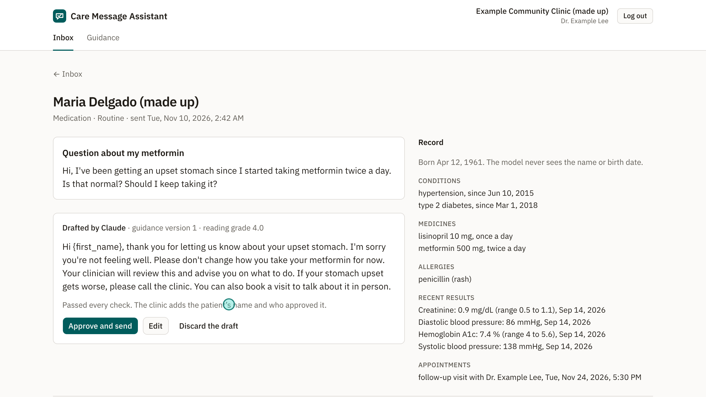

# Care Message Assistant

Helps a clinic's care team answer patients' portal messages. Red flags are caught in code before any model sees a message. Claude drafts a reply from the patient's record and the clinic's own guidance, code checks the draft against that record, and a clinician edits and approves the exact text before it reaches the patient. Every step is in an append-only audit log.

**Status:** built (M1–M7: data and FHIR; red flags and checks; sorting and drafting; logins, review and the log; sending and the portal; measurement; the showcase), with all 37 acceptance criteria proven ([the evidence page](docs/evidence/m6.html)). See [`AGENTS.md`](AGENTS.md) for the phases and [`docs/architecture.md`](docs/architecture.md) for the build order.

The third of four healthcare projects, after [Lab Report Assistant](https://github.com/Enriquez-Johnmark/lab-report-assistant) and [Care Reminders](https://github.com/Enriquez-Johnmark/care-reminders). Made-up clinic, made-up patients: this repository contains no real patient data and names no real company outside its research notes.

## See it

A captioned walkthrough (1 min 23 s), from fetching the messages to the patient reading an approved reply: [`docs/showcase/walkthrough.mp4`](docs/showcase/walkthrough.mp4). Screenshots and how to make them again: [`docs/showcase/`](docs/showcase/README.md).



## Why

Patient portal messages rose about 150% from 2020 to 2025, and primary care physicians spend close to an hour a day in the inbox. AI-drafted replies are already offered inside the big record systems. Published studies find they don't save time, though clinicians report less burden. In one study, 7.7% of unedited drafts could have caused severe harm, most often by not telling the patient to seek urgent care. (Sources: [`docs/research/README.md`](docs/research/README.md).) So this project is about the parts that keep a patient safe, each enforced in code and tested.

## What it does

- **Red flags first, in code (`b1`–`b4`):** chest pain, trouble breathing, stroke signs, thoughts of suicide or self-harm, severe bleeding, a severe allergic reaction, fainting, overdose, and a stiff neck with fever. These are found in casual words, odd spelling and the subject line. A negated phrase ("no chest pain") is still flagged: a false alarm costs a moment, a miss can cost a life. A flagged message never reaches the model. It goes to the top of the inbox with the clinic's fixed urgent reply ready.
- **The model never sees who the patient is (`a2`):** names, birth date, phone, email and address are taken out of the message, however the patient wrote them. The model gets only the record's facts (conditions, medicines, allergies, recent results, appointments) and the clinic's versioned guidance (`c3`, `c4`).
- **Sorting:** the model sorts each message as medication, symptom, test result or admin. Admin messages are answered from the clinic's template, never drafted (`c2`). An answer that doesn't parse leaves the message for a person (`c1`). With no model at all, the clinician writes the reply by hand (`c5`).
- **Seven checks on every draft, against the message and the record (`d1`–`d7`):**
  - a diagnosis;
  - starting, stopping or changing a medicine or dose;
  - a medicine not in the record;
  - a number or date not in the message or the record;
  - a promise;
  - over 150 words, or above 8th-grade reading level;
  - a wrong fill-in.

  Each problem names its check and what it found. All 40 hand-written bad drafts are blocked, each by exactly the check it was written to trip (`i1`).
- **Review (`e1`–`e4`):** only a clinician approves a clinical reply; the front desk approves only the admin template. An approval binds the exact text by its hash. Edits and replies written by hand go through the same checks. A discarded draft needs a reason.
- **Sending (`f1`–`f4`):** nothing reaches the portal without an approval, and a reply is sent once even if approved twice at the same moment. Code adds the disclosure: "This reply was drafted with the help of AI and reviewed and approved by Dr. Example Lee. To reach a person, call (555) 010-0200." The reply is written to the clinic's FHIR server as a `Communication` answering the message, once, even after a crash.
- **The portal (`a4`):** a patient logs in with an emailed link and sees only their own messages and approved replies.
- **The activity log (`g1`–`g3`):** every step, with who and when. The database itself refuses to change or delete an entry. Each message has its timeline; the administrator sees the whole log, filtered.
- **Data (`a1`, `h2`):** 20 made-up patients and 80 labelled made-up messages, loaded into a local HAPI FHIR server and read back through a strict reader that refuses what it can't read, with the reason.

## How it measures up

On the 80 labelled messages ([`evalset/report.md`](evalset/report.md), from Claude Sonnet's recorded answers):

| Measure | Result |
|---|---|
| Red flags caught in code | 19 of 19; 3 false alarms, all negated phrases |
| Messages sorted to their labelled type | 57 of 58 |
| Claude's drafts passing every check | 31 of 34 (91%), at about US$0.01 a draft |

The red-flag list was written before the labelled messages were read and caught **12 of 19** on that blind run. It was then widened, so 19 of 19 is no measure of recall on new wording. The drafts first passed 27 of 34. Five false alarms in the checks were fixed, each with a test. The 3 drafts still blocked name the medicine the patient asked about, which the checks rightly stop ([`evalset/README.md`](evalset/README.md)). It claims no time saved.

## Try it

```bash
docker compose --profile fhir up -d          # Postgres, Mailpit (http://localhost:8025) and HAPI FHIR (port 8090)
cp .env.example .env
pnpm install && pnpm --dir web install && pnpm --dir web build
pnpm cli migrate
pnpm cli add-staff --email dr.lee@clinic.example.test --name "Dr. Example Lee" --role clinician
pnpm cli add-staff --email admin@clinic.example.test --name "Example Administrator" --role administrator
pnpm cli load-made-up                        # only a FHIR server on this computer is accepted
pnpm cli serve --recorded                    # http://127.0.0.1:3000, drafting from the recordings: no key, no cost
```

Log in as the administrator and press "Fetch new messages". Then log in as the clinician to review: login emails arrive in Mailpit. To see the portal, log in with a made-up patient's address, such as `maria.delgado@example.test`. `pnpm test` runs the tests (Postgres and HAPI FHIR must be running); `pnpm cli eval` rebuilds the measurement from the recordings.

Any real use would need a model provider that signs a business associate agreement. The README makes no compliance claim; it says what the code enforces and how it is tested.

## Licence

All rights reserved ([LICENSE](LICENSE)). The source is published to be read, not reused.
